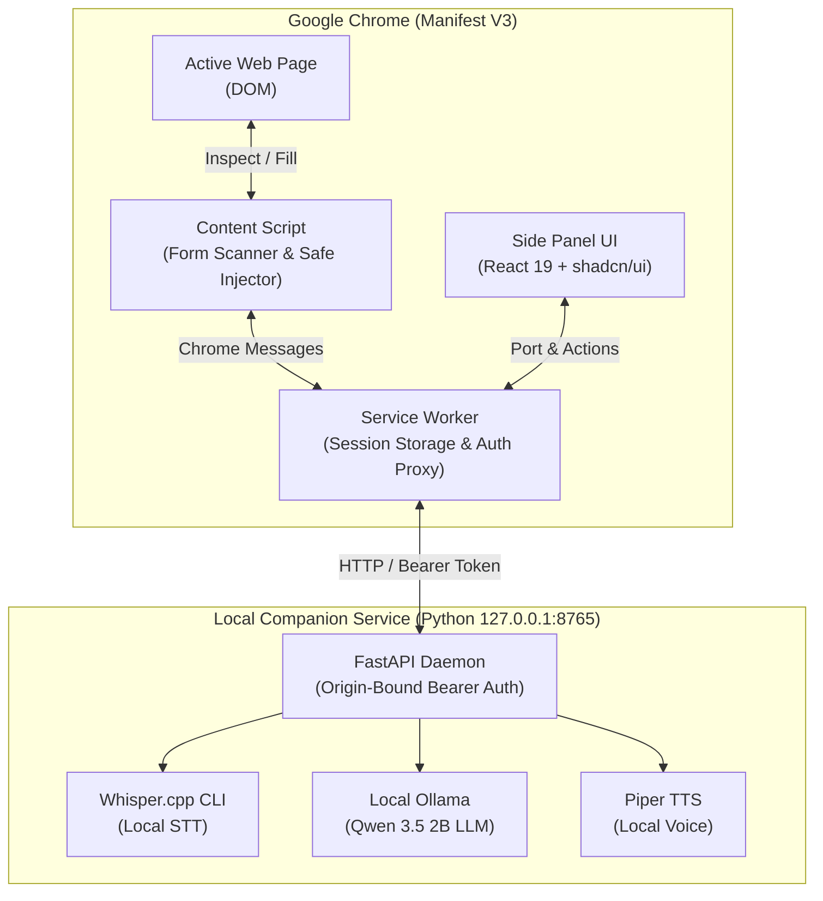

# Piko — Local-First Voice Web Form Assistant

> **A privacy-first Chrome Extension and local companion service that intelligently inspects, interprets, and fills web forms using local AI runtimes — zero cloud dependencies, zero data leakage.**

---

## 🌟 Overview & Key Principles

Piko allows users to fill complex web forms naturally through conversation and voice, without sending private personal data to the cloud.

Unlike typical AI browser extensions that scrape web pages and transmit personal data to remote servers:

1. **100% Local Processing:** Speech recognition ([Whisper.cpp](https://github.com/ggml-org/whisper.cpp)), natural language reasoning ([Ollama](https://ollama.com/) with Qwen), and speech synthesis ([Piper](https://github.com/rhasspy/piper)) run entirely on the user's computer.
2. **Permission-Gated Privacy:** The AI never modifies web forms on its own. It only proposes values. The user explicitly reviews, edits, selects, and approves the exact batch before any DOM field is populated.
3. **No Automatic Form Submission:** Piko never clicks submit buttons. Submitting forms remains under full manual user control.
4. **Sensitive Field Exclusion:** Passwords, OTPs/2FA codes, credit card numbers, file uploads, CAPTCHAs, and hidden elements are excluded automatically by the scanner.

---

## 🏗️ Architecture



---

## 📋 Prerequisites

| Component | Requirement | Purpose |
|---|---|---|
| **Node.js** | `>= 20.19.0` or `>= 22.12.0` | Extension build and JavaScript test suites |
| **Python** | `>= 3.11` | Local companion service (`apps/local-service`) |
| **Google Chrome** | `>= 116` | Developer Mode for loading unpacked extension |
| *(Optional)* **Ollama** | Latest | Local LLM inference (`ollama pull qwen3.5:2b`) |
| *(Optional)* **Whisper.cpp & FFmpeg** | Tested with v1.9.2 | Local voice transcription |
| *(Optional)* **Piper TTS** | via Python | Local spoken assistant responses |

---

## 🚀 Quick Start Setup

### Step 1: Install Dependencies and Build the Extension

From the repository root:

```bash
# Install root test dependencies
npm ci

# Install extension dependencies and compile production bundle
npm --prefix apps/extension ci
npm run build
```

> **Tip for active development:** Run `npm run dev:extension` to start the Vite dev server with hot-module reloading.

---

### Step 2: Set Up & Start the Local Companion Service

In a separate terminal:

```bash
cd apps/local-service
python3 -m venv .venv

# On Linux / macOS:
.venv/bin/python -m pip install -r requirements-dev.txt
.venv/bin/python -m app

# On Windows PowerShell:
# .\.venv\Scripts\python.exe -m pip install -r requirements-dev.txt
# .\.venv\Scripts\python.exe -m app
```

The service binds to **`127.0.0.1:8765`** and prints a **16-character one-time pairing code** to your terminal:

```text
[Pairing] One-time startup code: a1b2c3d4e5f6g7h8 (expires in 5 minutes)
INFO:     Uvicorn running on http://127.0.0.1:8765 (Press CTRL+C to quit)
```

---

### Step 3: Load the Extension into Google Chrome

1. Open Chrome and navigate to `chrome://extensions`.
2. Enable **Developer mode** using the toggle switch in the top-right corner.
3. Click **Load unpacked** and select the `apps/extension/dist/` folder from this repository.
4. Pin the **Piko** extension icon to your Chrome toolbar.
5. Click the Piko icon to open the Chrome Side Panel.

---

### Step 4: Pair Extension with Companion Service

1. In the Piko side panel, expand the **Local service connection** section.
2. Click **Check service** to verify the service is reachable.
3. Enter the 16-character code printed in your Python terminal, then click **Pair extension**.
4. Both **Service connected** and **Session active** will turn green.

---

## 🧪 Testing the Application Flow (End-to-End Walkthrough)

To experience the full scanner, review, and filling cycle, follow these practical steps:

### 1. Start the Included Test Fixture Server

Piko includes a comprehensive test form (`tests/fixtures/form-fixture.html`) containing text inputs, date pickers, dropdowns, radios, checkboxes, and sensitive inputs.

From the repository root:

```bash
python3 -m http.server 8787 --bind 127.0.0.1 --directory tests/fixtures
```

In Chrome, open: **`http://127.0.0.1:8787/form-fixture.html`**

---

### 2. Inspect the Web Form

1. Click Piko's toolbar icon on the fixture page tab to open the side panel.
2. Click **Inspect this page**.
3. **What happens:** The content script scans DOM form controls, extracting labels, IDs, types, and validation constraints.
4. **Privacy boundary:** Passwords, payment fields, hidden inputs, and existing form contents are never collected or sent.

---

### 3. Provide Answers & Propose Values

You can test proposals via **Manual Preparation** or **AI Natural Language**:

#### Option A: Manual Entry (Zero AI setup required)
1. In the side panel, click **Prepare manual answers**.
2. Fill in synthetic values for eligible fields (e.g. Full Name, Email, Organization).
3. Click **Review selected values**.

#### Option B: AI Interpretation (via local Ollama)
1. Ensure Ollama is running (`ollama serve`) with the model installed:
   ```bash
   ollama pull qwen3.5:2b
   ```
2. In the conversation input, enter a natural answer:
   > *"My name is Alex Mercer, my email is alex@example.com, and I work in Engineering."*
3. Click **Interpret edited answer**.
4. The local Qwen model maps your sentence to the scanned form fields.

---

### 4. Privacy Gate: Review, Edit & Approve

Before any data touches the webpage:

1. Proposed values are displayed in the review card with **all checkboxes initially unchecked**.
2. Select the specific fields you want to fill.
3. If a field on the page already has content, confirm the overwrite prompt.
4. Click **Approve and fill batch**.
5. **Outcome:** Piko fills the approved fields on the live page and triggers native input/change events, displaying verified status for each field.

---

### 5. (Optional) Voice Input & Spoken Responses

- **Speech Synthesis (Piper):**
  Download the English voice model:
  ```bash
  apps/local-service/.venv/bin/python -m piper.download_voices en_US-lessac-medium --data-dir apps/local-service/voices
  ```
  Set `PIPER_VOICE_PATH=voices/en_US-lessac-medium.onnx` before starting the service. In the side panel, click **Enable spoken responses and test voice**.
- **Voice Transcription (Whisper.cpp):**
  Configure the local `whisper-cli` executable and model. Click **Start voice recording**, speak for up to 20 seconds, and stop. Review and edit the generated transcript before submitting.

---

## 🛠️ Verification & Test Commands

Run the full verification suite to confirm contracts, schemas, extension UI, and service logic:

```bash
# Compile extension and build JSON contract validators
npm run build

# Run TypeScript type check and linter
npm run typecheck
npm run lint

# Run all Node.js unit and integration tests
npm test

# Run Python companion service tests (76 unit tests)
apps/local-service/.venv/bin/python -m unittest discover -s tests -p 'test_*.py' -v

# (Optional) Run Playwright browser automation tests
npx playwright install chromium
npm run test:browser
```

---

## 📁 Repository Structure

```text
├── apps/
│   ├── extension/          # Manifest V3 Chrome Extension (React 19 + TypeScript + Vite)
│   │   ├── src/
│   │   │   ├── sidepanel/  # Extension Side Panel UI & State Management
│   │   │   ├── content/    # Content Script (DOM Form Scanner & Safe Injector)
│   │   │   └── background/ # Service Worker (Storage, Permissions & Service Proxy)
│   │   └── dist/           # Built unpacked extension loaded into Chrome
│   │
│   └── local-service/      # Python Companion Service (FastAPI + Uvicorn)
│       ├── app/            # Endpoints: /v1/health, /v1/pair, /v1/interpret, /v1/transcribe, /v1/synthesize
│       └── requirements.txt
│
├── contracts/              # Shared JSON Schema definitions (scanner, interpretation, fill grants)
├── docs/                   # Detailed technical specifications and threat models
├── tests/                  # Automated integration tests and browser specs
│   ├── fixtures/           # Synthetic test forms (form-fixture.html) and mock cases
│   └── *.test.cjs          # Test runner suites
└── scripts/                # Live verification and benchmarking utilities
```

---

## 🔒 Security & Privacy Guarantees

- **Loopback-Only Communication:** Extension communication is restricted strictly to `127.0.0.1:8765`.
- **Extension-Origin Binding:** The Python companion validates the Chrome extension ID and rejects requests from normal web origins.
- **In-Memory Session Tokens:** Authentication tokens are stored exclusively in `chrome.storage.session` and never written to disk or shared with content scripts.
- **Fail-Closed Permissions:** Navigating to a new URL, switching tabs, or modifying the form immediately revokes active approval tokens.

---

## ❓ Troubleshooting & FAQs

<details>
<summary><b>Pairing code expired or invalid</b></summary>
Pairing codes expire after 5 minutes and can only be used once. Restart the local service (<code>Ctrl+C</code> and run <code>.venv/bin/python -m app</code>) to generate a new 16-character code.
</details>

<details>
<summary><b>Can I test without setting up Ollama, Whisper, or Piper?</b></summary>
Yes! The extension includes a self-contained synthetic demo (<b>Load demo form</b> in the side panel) and allows full form inspection and manual filling on <code>form-fixture.html</code> without any AI runtime.
</details>

<details>
<summary><b>Extension changes are not showing up in Chrome</b></summary>
After making code changes, run <code>npm run build</code>, then visit <code>chrome://extensions</code> and click the reload icon on Piko.
</details>

---

## 📚 Deep Dive Documentation

For in-depth subsystem guides, consult the reference documents in [`docs/`](docs/):

- [Product Specification](docs/01-product-spec.md)
- [Privacy Threat Model](docs/02-privacy-threat-model.md)
- [Acceptance Tests](docs/03-acceptance-tests.md)
- [Development Setup Details](docs/04-development-setup.md)
- [Form Scanner Specification](docs/06-form-scanner.md)
- [Permission-Gated Filling Guide](docs/07-permission-gated-filling.md)
- [Companion Service Connection & Auth](docs/08-local-service-connection.md)
- [Local Whisper Voice Input Guide](docs/09-local-voice-input.md)
- [Local Qwen Interpretation Guide](docs/10-local-qwen-interpretation.md)
- [Local Piper Speech Synthesis Guide](docs/11-local-piper-speech.md)

---


# Original PIKO Implementation Plan (preserved)

## 1. Goal and Design Decision

Build a local voice assistant that identifies web-form fields, reuses approved information, asks for missing answers, and automatically fills the form within user-granted permissions.

Compare these two approaches:

| Aspect | Sequential voice workflow | Privacy-first preview workflow |
|---|---|---|
| Interaction | Ask, transcribe, fill, confirm each field | Prepare answers privately, then approve filling |
| Strength | Clear conversational guidance | Prevents disclosure before approval |
| Limitation | Repetitive questions; confirmation happens after disclosure | Repeated field selection can undermine automation |
| Recommended combination | Ask only for missing or uncertain details; approve a batch before inserting it | |

**Chosen behavior:** prepare privately → approve destination and fields → fill automatically → ask only when new permission or clarification is needed.

Approval occurs before insertion. Submission remains manual.

## 2. Architecture and Interfaces

Use a Chrome extension connected to a local companion service.

| Component | Technology | Responsibility |
|---|---|---|
| Extension | Manifest V3, TypeScript, React, Vite | Side panel, microphone recording, permissions, review |
| Form adapter | Content script, MutationObserver | Extract fields, insert approved values, observe changes |
| Local service | Python, FastAPI, Pydantic | Coordinate speech, model inference, validation |
| Speech recognition | whisper.cpp | Transcribe recordings locally |
| Language model | Ollama, local Qwen3.5 2B (configurable) | Interpret answers and propose field mappings |
| Speech synthesis | Piper | Speak questions and progress messages |
| Temporary profile | Extension memory | Reuse explicitly selected details during the active session |

Use English for the initial demo. Additional languages require separate transcription, model, and voice testing.

Do not persist profiles in the prototype. Closing the session clears its reusable information.

**Service interface:**

- `GET /health`: report model and speech-engine readiness.
- `POST /transcribe`: accept a short recording and return text.
- `POST /interpret`: accept allowed field definitions and the current answer; return proposed updates and clarification questions.
- `POST /synthesize`: accept a question and return speech audio.

Requests require a per-installation pairing token. Keep the service bound to loopback and allow only the paired extension origin.

**Field identity:**

The extension assigns opaque IDs to supported fields and maintains their DOM references. AI returns IDs, never executable JavaScript or generated selectors.

```json
{
  "updates": [
    {
      "fieldId": "field_17",
      "value": "Ayham"
    }
  ],
  "clarifications": []
}
```

Reject unknown IDs, unsupported values, and stale form references. Structured output controls shape; application code must still validate meaning.

## 3. Execution and Privacy Rules

1. **Activate:** the user starts Piko on the current page.
2. **Inspect:** extract visible, enabled fields, associated labels, options, instructions, and constraints. Exclude hidden inputs and unrelated page content.
3. **Plan:** match approved session details to fields; identify missing answers. Generate a short form summary.
4. **Converse:** Piper asks about missing information. Record with push-to-talk and transcribe locally. Stop recording during speech playback.
5. **Interpret:** allow one answer to populate several proposed values. Ask targeted questions for ambiguity; never invent information.
6. **Preview:** show the destination origin, proposed values, and their source. Users can edit or deselect values.
7. **Approve and fill:** create an in-memory permission containing the origin, tab, form instance, and exact field-value pairs. Fill that batch without further prompts.
8. **Verify:** use appropriate input/change events and check accepted values and browser validation. Report failures rather than claiming completion.
9. **Observe:** newly revealed fields start unapproved. Collect missing answers and approve them together in another batch.
10. **Finish:** show remaining issues and provide a final review. The user submits through the website.

Additional boundaries:

- A spoken confirmation after filling does not replace approval before filling.
- Changed values require new approval; existing permission cannot authorize different personal data.
- Expire permission after navigation, origin change, form replacement, or session end.
- Exclude passwords, OTPs, payment credentials, and detected identity-number fields. Unsupported or uncertain sensitive fields remain manual.
- Do not support cross-origin frames, CAPTCHA solving, file uploads, or automatic navigation in this version.
- Treat webpage instructions as untrusted data. They cannot override permissions or authorize tool calls.
- Keep audio temporary. Exclude recordings, transcripts, and field values from logs and analytics.
- Disable cloud inference and cloud fallbacks. Bundle application assets locally.
- Explain that approved websites may read inserted values before submission; clearing values cannot reverse disclosure.

## 4. Fourteen-Hour Build Sequence

Assume one developer and an existing computer; the schedule is a prototype target, not a production-release estimate.

| Time | Deliverable |
|---|---|
| Hours 0–1 | Install models; benchmark transcription, extraction, and Piper playback on the demo computer |
| Hours 1–4 | Extension panel, field registry, inspection, permission preview, deterministic filling |
| Hours 4–6 | Local service, recording conversion, Whisper transcription, Piper playback |
| Hours 6–8 | Structured answer extraction, validation, multi-field answers, clarification |
| Hours 8–10 | Session profile reuse and permission enforcement |
| Hours 10–12 | Conditional fields, validation feedback, corrections, failure handling |
| Hours 12–14 | End-to-end checks, user trials, demo recording, setup documentation |

Start with a multilingual Whisper base model and local Qwen3.5 2B. If response times are unacceptable, benchmark Whisper tiny; retain text input as a fallback. Do not silently switch to cloud processing.

The hardware benchmark is a release gate: if the available machine cannot run the local pipeline acceptably, report that limitation rather than promise real-time voice.

Expected incremental AI API and hosting spend: **₹0**, assuming existing hardware and local execution. Electricity, downloads, packaging, support, and any hardware purchases are additional costs.

Before distributing binaries, review the selected runtime, model, Piper, and voice licenses.

## 5. Validation and Release Criteria

Use synthetic personal information and two controlled test forms with different labels and layouts. Include text, email, select, radio, checkbox, repeated labels, and one conditional section.

**Required checks:**

- One spoken answer proposes values for multiple correct fields.
- Ambiguous answers produce clarification.
- No personal values enter the webpage before approval.
- Deselecting a field prevents insertion.
- Permission cannot transfer to another origin, tab, or replaced form.
- Hidden, excluded, and unknown fields remain untouched.
- Conditional fields trigger another private preparation-and-approval cycle.
- Invalid values are surfaced and can be corrected.
- Unauthenticated local requests are rejected.
- Voice inference works with external networking blocked after setup.
- Model failure preserves the draft and permits manual completion.

**Initial targets, to be measured rather than advertised as achieved:**

- At least 95% correct field-value proposals over 40 defined test cases.
- Zero unapproved insertions in the permission test suite.
- Median end-of-recording to displayed proposal below five seconds on the documented demo hardware.
- At least four of five trial users finish both supported forms without developer assistance.

Compare completion time, corrections, and prompts against manual completion with browser autofill enabled. Record first-use and repeat-use results separately.

Publish an installable prototype only after documenting its hardware requirements, supported form types, privacy boundaries, measured results, and known failures. Broad website support and accessibility benefits remain claims to validate.

